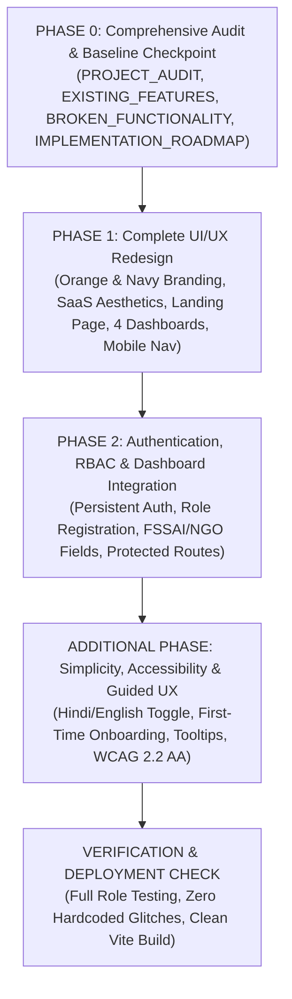

# UNION FOOD BRIDGE — IMPLEMENTATION ROADMAP (PHASE 0 — PHASE 3)
**Audit Date:** October 31, 2026  
**Repository:** `NinjaCodeGirl/Union_FoodBridge`  
**Execution Strategy:** Multi-Phase Progressive Enhancement with Zero Regression on Existing Business Logic.

---

## 1. PHASED IMPLEMENTATION TIMELINE

---

## 2. DETAILED PHASE BREAKDOWN

### PHASE 0: CODEBASE AUDIT & BASELINE CHECKPOINT (COMPLETED)
- [x] Create clean baseline git commit and checkout working branch `upgrade/phase0-audit-and-redesign`.
- [x] Inspect all frontend components, backend routers, database schemas, and configuration files.
- [x] Identify and classify all 20 existing and planned features.
- [x] Deliver `PROJECT_AUDIT.md`, `EXISTING_FEATURES.md`, `BROKEN_FUNCTIONALITY.md`, and `IMPLEMENTATION_ROADMAP.md`.

---

### PHASE 1: COMPLETE FOODBRIDGE UI/UX REDESIGN
**Objective**: Transform FoodBridge into a premium, responsive food redistribution SaaS platform adhering strictly to the **Orange and dark navy/black branding** with light neutral surfaces, clean spacing, and modern typography.

#### 1.1 Brand & Design System Foundations
- Update `tailwind.config.js`:
  - **Primary**: `#EA580C` (Vibrant Orange), `#C2410C` (Dark Orange), `#FFEDD5` (Soft Orange Light).
  - **Navy/Black Accents**: `#0F172A` (Slate/Dark Navy), `#020617` (Deep Dark Black/Navy), `#1E293B` (Navy Card Subtle).
  - **Surfaces**: `#F8FAFC` (Clean SaaS neutral background), `#FFFFFF` (Card surface), `#F1F5F9` (Subtle borders).
  - **Status**: Emerald `#10B981` (Fresh/Success), Amber `#F59E0B` (Warning/Urgent), Red `#EF4444` (Critical).
- Update typography: Inter for body copy, Space Grotesk for crisp headings and metrics.

#### 1.2 Dedicated Public Landing Page (`src/components/landing/LandingPage.jsx`)
- **Navbar**: Logo with food redistribution icon, Navigation links (Home, About Us, How It Works, Impact, Pricing), Language toggle (English / हिंदी), and Login / Join Now CTA.
- **Hero Section**: Strong FoodBridge mission statement ("Bridging Commercial Surplus with Verified Shelters in Real-Time"), interactive live stats ticker, dynamic CTAs.
- **How It Works**: 3-step interactive visual explainer:
  1. *Commercial Kitchen Lists Food*: AI Freshness analysis and thermal safety checks.
  2. *Algorithmic Proximity Dispatch*: Proximity matching & automated multi-NGO batch splitting.
  3. *Cryptographic Handshake*: Secure QR code verification & instantaneous CO2 mitigation logging.
- **AI Freshness & Food Safety Showcase**: Interactive visual demonstrating initial safety screening and decay curves.
- **QR Handshake & Verification Showcase**: Explaining cryptographic JWT tokens preventing food diversion.
- **Live Tracking & Route Coordination**: Visual explanation of volunteer courier proximity dispatch.
- **Verified Impact Statistics**: Real aggregated metrics from `ImpactTrackerService`.
- **Transparent B2B Pricing Section**: Complete 4-tier plan presentation.
- **Footer**: FSSAI compliance notices, contact details, emergency helpline, and copyright.

#### 1.3 Four Independent Role Dashboards
1. **Restaurant / Surplus Partner Dashboard (`DonorDashboard.jsx`)**:
   - Live analytics: Total meals donated, CO2 avoided, active listings, pending pickups.
   - Quick Action: "+ Post Surplus Food" opening the 4-step wizard.
   - Active listings table with QR sharing, camera evidence, and WhatsApp alerts.
   - Live pickup tracking card with volunteer ETA countdown.
   - Subscription tier status badge and quick upgrade link.
2. **NGO / Recipient Dashboard (`RecipientDashboard.jsx`)**:
   - Nearby surplus food feed with real "Request Food" portion claim modal.
   - Integrated Live Proximity Map with **interactive radius search slider** (3 km, 5 km, 10 km, 25 km).
   - "My Requests & Claims" tracker with arrival ETA.
   - "Confirm Delivery / Scan QR" action.
   - "Record Distribution" modal to record meals served to beneficiaries.
3. **Volunteer / Delivery Courier Dashboard (`VolunteerDashboard.jsx`)**:
   - Available pickup assignments in volunteer's service area.
   - Accepted pickups with step-by-step pickup/delivery navigation.
   - Live ETA countdown and vehicle information.
   - Pickup QR scanner / 6-digit OTP confirmation.
   - Delivery confirmation and proof-of-handover recording.
   - Completed assignment history and total volunteer hours/meals delivered.
4. **Platform Admin Dashboard (`AdminDashboard.jsx`)**:
   - Platform overview: System-wide food flow, active donors, verified NGOs, active couriers.
   - B2B SaaS Revenue Analytics (MRR, ARR, churn) and Unit Economics Simulator.
   - FSSAI Compliance & Audit Trail ledger with SHA-256 tamper-evident records.
   - Organization verification approvals.

#### 1.4 Responsive Mobile Experience
- Persistent mobile bottom navigation bar (`MobileBottomNav.jsx`) with role-tailored primary actions.
- Touch-friendly controls with >= 44x44px touch targets.
- Responsive map container with mobile pinch-zoom and radius selector.
- Touch-friendly card view for all data lists on mobile.

---

### PHASE 2: AUTHENTICATION, RBAC & DASHBOARD INTEGRATION
**Objective**: Audit and repair the authentication system. Replace the cosmetic dropdown switcher with persistent, secure, role-verified access control.

#### 2.1 Unified Authentication System (`src/context/AuthContext.jsx` & `AuthModal.jsx`)
- Support Registration, Login, Logout, Forgot Password, and persistent sessions via `localStorage`.
- Server-verified roles: `RESTAURANT`, `NGO`, `VOLUNTEER`, `ADMIN`.
- Route guards preventing unauthorized cross-role access (e.g. an NGO cannot view Admin revenue figures or another donor's private settings).

#### 2.2 Role-Specific Registration
- **Restaurant Registration**: Business name, contact person, verified phone, address, GPS location, business type, FSSAI 14-digit license number, daily surplus estimate.
- **NGO Registration**: Organization name, Darpan / 80G registration number, contact person, address, GPS location, beneficiary capacity (meals/day), cold storage availability.
- **Volunteer Registration**: Full name, mobile number, GPS service radius, transport mode (Walking, Bicycle, Motorbike, Van), ID verification status.

#### 2.3 Real Data Linkage & Backend Synchronization
- Bind each dashboard to the logged-in user's profile and real database records.
- Implement proper loading skeletons, empty states, and error alerts.
- Connect WhatsApp dispatch links with pre-filled message text.
- Connect camera-based QR scanning and 6-digit OTP verification.

---

### ADDITIONAL PHASE: SIMPLICITY, ACCESSIBILITY & USER EXPERIENCE
**Objective**: Make Union FoodBridge intuitive for users of all digital literacy levels, accessible across all devices, and bilingual.

#### 3.1 Plain English & Hindi Language Support
- Global Language Switcher (English / हिंदी) in Navbar and Mobile Drawer.
- Translates core actions: "Add Surplus Food" (अतिरिक्त भोजन जोड़ें), "Find Nearby Food" (आस-पास भोजन खोजें), "Request Food" (भोजन का अनुरोध करें), "Scan QR" (QR स्कैन करें), "Confirm Delivery" (डिलीवरी की पुष्टि करें).
- Simple, friendly error messages free from technical jargon.

#### 3.2 First-Time User Guided Onboarding Tutorial
- Role-specific 3-step walkthrough explaining:
  1. What this dashboard does.
  2. How food is matched and verified.
  3. What the user's first action should be.
- Ability to dismiss/skip tutorial, and re-open at any time via "How It Works / सहायता".

#### 3.3 Clear Explanations for Advanced Features
- Plain language info tooltips explaining:
  - **AI Freshness**: *"We inspect the uploaded food details and temperatures for safety. This is an initial screening, not a substitute for food safety inspection."*
  - **Cryptographic QR**: *"Scan this code to confirm that the correct donation is being handed over to the authorized volunteer."*
  - **Live Tracking**: *"See how far your assigned volunteer courier is from the kitchen loading dock."*
  - **Distribution Record**: *"Record how much food was actually served to beneficiaries to generate verified impact certificates."*

#### 3.4 WCAG 2.2 AA Accessibility
- High contrast text on all light neutral and orange surfaces.
- Full keyboard navigation (`Tab`, `Enter`, `Escape` for modals).
- Screen-reader aria labels (`aria-label`, `role="dialog"`, `aria-expanded`).

---

## 3. EXACT LIST OF PRESERVED EXISTING FEATURES

1. **AI Freshness & Shelf-Life Assessment**: Decay curves, category multipliers, and SHA-256 validation hash.
2. **Food Image & Photo Upload**: Image preview in donation creation wizard.
3. **Food Quantity Management**: Servings, weight in kg, dietary tags, and packaging categories.
4. **Multi-NGO Batch Splitting**: Haversine distance matrix and priority ranking algorithm.
5. **Cryptographic QR Token Generation**: HS256 JWT tokens with embedded allocation metadata.
6. **QR Verification & Handshake Logic**: Signature verification and CO2 avoidance calculations.
7. **Proximity Leaflet Map**: Geo-coordinates, OpenStreetMap tiles, and custom category pins.
8. **Surplus Food Browse & Search Feed**: Category filtering and text search.
9. **Ola-Style Phone Contact Sharing**: Contact details masking, call simulation, and call audit logging.
10. **Trust Rating & Review System**: 5-star ratings for hygiene and punctuality.
11. **Civic & Environmental Impact Tracker**: Rescued meals, CO2 avoided, and landfill diversion stats.
12. **B2B SaaS Pricing Plans**: 4 tiers (Community Free, Food Partner Pro, Business Plus, Enterprise & CSR).
13. **Sandbox Subscription Checkout**: GST invoice generation and plan upgrade/downgrade simulation.
14. **Admin Revenue & Unit Economics Models**: ARR, MRR, CAC/LTV, and cost-per-delivery projections.
15. **Compliance Records Ledger**: FSSAI regulatory log and temperature excursion audit trail.

---

## 4. EXACT FILES NEEDING MODIFICATION & CREATION

### Existing Files to Modify
- `tailwind.config.js`: Add Orange & Dark Navy branding tokens, neutral surfaces, and font definitions.
- `index.html`: Update title, meta tags, and font imports.
- `src/App.jsx`: Integrate landing page, authentication context, 4 distinct role dashboards, and radius search.
- `src/components/layout/AppShell.jsx`: Apply Orange/Navy styling and role-specific navigation.
- `src/components/navigation/TopNavbar.jsx`: Replace mock dropdown with user profile, auth buttons, and language toggle.
- `src/components/navigation/Sidebar.jsx`: Update with role-specific navigation and orange branding.
- `src/components/navigation/MobileBottomNav.jsx`: Update with touch-friendly role actions.
- `src/components/navigation/ResponsiveDrawer.jsx`: Add language switcher and role profile info.
- `src/components/donor/DonationWizard.jsx`: Enhance step-by-step UX, visual freshness tips, and orange branding.
- `src/components/donor/DonorDashboard.jsx`: Add WhatsApp dispatch links, live route ETA card, and dynamic user data.
- `src/components/LiveMap.jsx`: Convert from dark theme to light SaaS theme; add radius slider filter (3/5/10/25 km) and user GPS location.
- `src/components/SurplusFeed.jsx`: Convert from dark theme to light SaaS theme; add "Request Food" portion claim modal and radius filtering.
- `src/components/QRModal.jsx`: Add real camera scanner via HTML5 video stream, 6-digit OTP code, and WhatsApp share link.
- `src/components/ContactSharingModal.jsx`: Add direct WhatsApp chat button (`wa.me`) with pre-formatted message.
- `src/components/Leaderboard.jsx`: Convert from dark theme to light SaaS theme.
- `src/components/Dashboard.jsx`: Update styling and link cleanly to landing page and role dashboards.
- `backend/app/services/freshness_ai.py`: Update Gemini candidate model names to current API specifications.

### New Files to Create
- `src/context/AuthContext.jsx`: Authentication provider, persistent session storage, and role management.
- `src/components/auth/AuthModal.jsx`: Modal for Registration and Login with role-specific fields (FSSAI, NGO capacity, vehicle).
- `src/components/landing/LandingPage.jsx`: Public landing page with Hero, Mission, How It Works, AI Freshness, QR Verification, Live Tracking, Impact, Pricing, and Footer.
- `src/components/recipient/RecipientDashboard.jsx`: Dedicated dashboard for NGOs with nearby food, radius search, active requests, pickup QR, and distribution records.
- `src/components/volunteer/VolunteerDashboard.jsx`: Dedicated dashboard for Volunteers with available pickups, ETA navigation, camera QR scanning, and delivery proof.
- `src/components/admin/AdminDashboard.jsx`: Dedicated dashboard for Platform Admins with user verification, revenue analytics, unit economics, and FSSAI audit ledger.
- `src/components/recipient/RequestFoodModal.jsx`: Modal for NGOs to claim servings from a surplus listing.
- `src/components/recipient/RecordDistributionModal.jsx`: Modal for NGOs to log meals served to beneficiaries.
- `src/components/qr/CameraQRScanner.jsx`: Live camera QR scanner with fallback 6-digit OTP verification.
- `src/utils/whatsapp.js`: Utility for generating pre-formatted WhatsApp notification and coordination links.
- `src/utils/translations.js`: English and Hindi bilingual dictionary for key UI labels and instructions.

---

## 5. AUDIT CONCLUSION & READINESS FOR PHASE 1

The Phase 0 audit is now 100% complete:
- Baseline commit created on branch `upgrade/phase0-audit-and-redesign`.
- All 4 audit deliverables (`PROJECT_AUDIT.md`, `EXISTING_FEATURES.md`, `BROKEN_FUNCTIONALITY.md`, `IMPLEMENTATION_ROADMAP.md`) are generated.
- Preservation matrix covers all 15 core features.
- Files to modify and new files to create are documented with precision.

We are ready to begin **Phase 1: Complete UI/UX Redesign & Landing Page Implementation**.
